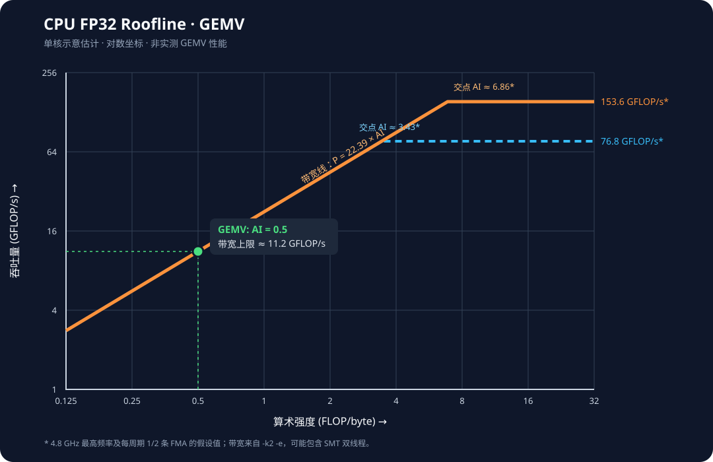

# How to optimize GEMV kernel

## 测试带宽
### 准备工具

- [Intel Memory Latency Checker (MLC)](https://www.intel.com/content/www/us/en/developer/articles/tool/intelr-memory-latency-checker.html)：测量内存延迟与带宽。
- 解压后进入包含 `mlc` 可执行文件的目录，分别测量全核、单核及部分核心的顺序访问带宽：

    ```bash
    tar xvf mlc-3.13.tgz
    cd Linux

    # 全核
    ./mlc --peak_injection_bandwidth -e

    # 指定核心 2；-X 限制为该核心的一个硬件线程
    ./mlc --peak_injection_bandwidth -k2 -X -e

    # 指定部分核心
    ./mlc --peak_injection_bandwidth -k2,3,4,5 -X -e
    ```

- `-e` 不修改当前硬件预取器状态。比较不同测试结果时，要保持核心、硬件线程数及运行环境一致。

### 解读结果

以下是一次使用 `-k2 -e`（未加 `-X`）的单核测试输出；若启用超线程，MLC 会使用该核心上的所有硬件线程：

```text
Intel(R) Memory Latency Checker - v3.13
Command line parameters: --peak_injection_bandwidth -k2 -e

Using buffer size of 133.167MiB/thread for reads and an additional 133.167MiB/thread for writes
*** -e leaves the hardware prefetchers as they are, and this run uses a
*** sequential access pattern. If the prefetchers are enabled, the reported
*** latency will be a prefetched cache hit rather than a memory latency.
*** Add -r to use a random access pattern if that is not what you want.

Measuring Peak Injection Memory Bandwidths for the system
Bandwidths are in MB/sec (1 MB/sec = 1,000,000 Bytes/sec)
Using all the threads from each core if Hyper-threading is enabled
Using traffic with the following read-write ratios
ALL Reads        :       22385.8
3:1 Reads-Writes :       24605.3
2:1 Reads-Writes :       32470.4
1:1 Reads-Writes :       29124.5
Stream-triad like:       34133.8
```

| 访问模式 | 测得带宽 | 对 GEMV 的意义 |
| --- | ---: | --- |
| ALL Reads | 22.39 GB/s | 矩阵读取占主导时的主要参考值 |
| 3:1 Reads-Writes | 24.61 GB/s | 混合读写负载，不能直接代替只读带宽 |
| 2:1 Reads-Writes | 32.47 GB/s | 同上 |
| 1:1 Reads-Writes | 29.12 GB/s | 同上 |
| Stream-triad like | 34.13 GB/s | 类似流式向量运算，可作为辅助参考 |

> MLC 的 MB/s 采用十进制单位：$1\ \mathrm{GB/s}=1000\ \mathrm{MB/s}$。这里的数值来自 `-k2 -e`，不能与全核带宽混用。`-e` 输出中关于预取的提示主要针对延迟解读；这里关注的是顺序访问带宽。

### 估算 GEMV 的带宽下界

- 当前 GEMV 使用 `float` 矩阵，形状为 $M\times N$。忽略向量与输出的数据流量时，矩阵读取量约为 $4MN$ 字节，运算量约为 $2MN$ FLOPs，算术强度约为 $0.5$ FLOP/字节。
- 若矩阵大于缓存、每次计算需要从内存读取，以上述 **22.39 GB/s** 的测试结果作乐观估计：

    $$
    t_{\min}\approx\frac{4MN}{22.39\times10^9}\ \mathrm{s},
    \qquad
    P_{\max}\approx0.5\times22.39=11.2\ \mathrm{GFLOP/s}.
    $$

- 例如 $M=N=4096$ 时，矩阵约为 **67.1 MB**，理想读取耗时约 **3.0 ms**。如果改用此前测得的 **67.15 GB/s 全核带宽**，乐观下界才约为 **1.0 ms**，对应约 **33.6 GFLOP/s**；全核数字不能直接作为单核 GEMV 的目标。
- 如果矩阵驻留缓存，则 DRAM 带宽下界不适用；应根据实际线程数、核心类型和工作集大小对照 GEMV 的实测耗时。

## 测试算力

### 单核 FP32 理论峰值（不是 GEMV 实测值）

- 当前机器为 Intel Core Ultra 7 155H；逻辑 CPU 2 属于核心 1，支持 AVX2 和 FMA，系统报告该核心最高频率为 **4.8 GHz**。最高频率不是运行 GEMV 时的持续频率。
- 以一条 256-bit FP32 FMA 为例，每条指令处理 8 个 `float`，乘加计作 $8\times2=16$ FLOPs。假设该核心持续每周期执行 **1 条**这样的 FMA，理论吞吐为：

    $$
    P_{\mathrm{compute}}=16\times f_{\mathrm{GHz}}\ \mathrm{GFLOP/s};
    \quad f=4.8\ \mathrm{GHz}\ \text{时为}\ 76.8\ \mathrm{GFLOP/s}.
    $$

- 若微架构能持续每周期执行 **2 条**独立的 256-bit FMA，则按同一最高频率计算是 **153.6 GFLOP/s**。这是**条件估算**，不是已测得该核心具有两条 FMA 流水线，也不代表 GEMV 可达到此值；实际应使用运行时频率及测得的指令吞吐校正。
- 当前 [`gemv_ref`](../src/micro/gemv/gemv_ref.hpp) 逐元素更新每行的累加器，没有手写 SIMD，也存在累加依赖，因此不能直接用上述向量化峰值预测它的性能。

## Roofline估计

### CPU Roofline估计



- 横轴为算术强度 $I$（FLOP/byte），纵轴为吞吐 $P$（GFLOP/s），均为对数刻度。Roofline 由带宽线与算力平台的较小值决定：

    $$P\leq\min(B\times I,\ P_{\mathrm{compute}}).$$

- 橙色实线用 **22.39 GB/s** 只读带宽与**假设**的 **153.6 GFLOP/s** 峰值作图，转折点 $I=153.6/22.39\approx6.86$ FLOP/byte。蓝色虚线是每周期 1 条 FMA 的 **76.8 GFLOP/s** 假设，转折点约 $3.43$ FLOP/byte。
- 两个算力平台都以 **4.8 GHz 最高频率**计算，并非持续算力实测值；带宽来自 `-k2 -e`，也可能含同核心的多个硬件线程。因此此图仅用于说明数量级，不能视为已验证的**单硬件线程** Roofline。应以 `-k2 -X -e` 的带宽和实测的持续算力更新图中的参数。

### GEMV AI计算强度

| input A | input B | output C |
| --- | --- | --- |
| $M\times K$ | $K\times N$ | $M\times N$ |

- All memory traffic: $4(MK+KN+MN)$ bytes
- FLOPs: $2(MKN)$
- AI: $\frac{2MKN}{4(MK+KN+MN)}$ FLOP/byte.

对于GEMV来说，M=1，且A和C都是向量，可以忽略它们的数据流量。则AI约等于 $0.5$ FLOP/byte。

### 大矩阵实测描点与理论对比

- 使用单个逻辑 CPU、AVX2 后端且**未启用** `--perf` 的基准结果：
    ```bash
    taskset -c 2 ./benchmark/bench_ops --op matmul --shape 1,7680,30720 --backend avx2 --warmup 5 --iters 50
    op=matmul shape=1,7680,30720 warmup=5 iters=50
    min=46018.787 us  median=46133.991 us  mean=46222.141 us  output[0]=2878.781
    ```

- 这里是行向量 $[1,K]$ 乘权重矩阵 $[K,N]$，$K=7680$、$N=30720$；**不是 GPT-2 small 的实际层尺寸**，而是用于观察大于缓存时的 DRAM 行为。权重矩阵大小为
    $4KN=943{,}718{,}400$ 字节 $=900$ MiB，大于本机的 24 MiB L3 缓存。以中位耗时 $t=46{,}133.991\ \mu\mathrm{s}\approx0.046134\ \mathrm{s}$ 计算：

    $$
        \begin{aligned}
        F &= 2KN = 471{,}859{,}200\ \mathrm{FLOPs},\\
        I &= \frac{2KN}{4(KN+K+N)}\approx0.500\ \mathrm{FLOP/byte},\\
        P_{\mathrm{actual}} &= \frac{2KN}{t\times10^9}\approx10.23\ \mathrm{GFLOP/s},\\
        B_{\mathrm{effective}} &= \frac{4KN}{t\times10^9}\approx20.46\ \mathrm{GB/s}.
        \end{aligned}
    $$

- 在上面的 Roofline 图上，**实测点为 $(I,P)\approx(0.5,10.23)$**，即 $x=0.5$、$y$ 略高于 10 GFLOP/s。$B_{\mathrm{effective}}$ 是按矩阵大小推算的**表观读取带宽**，不是硬件计数器测得的 DRAM 流量。

- 用前述 MLC 的 **22.39 GB/s** 只读带宽作为暂时参考，带宽约束下的吞吐上限与效率为：

    $$
        P_{\mathrm{roof}}\approx\min(22.39\times0.5,\ P_{\mathrm{compute}})
        \approx11.20\ \mathrm{GFLOP/s},\qquad
        \eta=\frac{P_{\mathrm{actual}}}{P_{\mathrm{roof}}}
        \approx\frac{10.23}{11.20}\approx91\%.
    $$

- **42.15 ms 的来源**：只考虑从 DRAM 读取一次权重矩阵，按字节数除以带宽：

    $$
        t_{\min}\approx\frac{4KN}{B}
        =\frac{943{,}718{,}400\ \mathrm{byte}}
                     {22.39\times10^9\ \mathrm{byte/s}}
        \approx0.04215\ \mathrm{s}=42.15\ \mathrm{ms}.
    $$

    MLC 使用十进制 GB/s（$10^9$ 字节/秒）；矩阵的 **900 MiB** 使用二进制单位，不能直接拿 $900/22.39$ 算毫秒。实际中位耗时为 **46.13 ms**，比该乐观下界高约 **3.98 ms**。下界忽略输入/输出流量与执行开销。

- **不要把 91% 当作严格的单线程带宽利用率**：benchmark 固定在逻辑 CPU 2，而带宽 22.39 GB/s 来自 `-k2 -e`，可能用了该核心的全部硬件线程。应重新以 `-k2 -X -e` 测单硬件线程只读带宽，确认选中的硬件线程与绑核一致，再计算 $P_{\mathrm{roof}}=\min(BI,P_{\mathrm{compute}})$ 和 $\eta=P_{\mathrm{actual}}/P_{\mathrm{roof}}$。若矩阵可能命中缓存或核的运行频率发生变化，也要重新评估 Roofline 的适用条件。

## 理论性能
```text
gemv([vocab_size, n_embd], [n_embd]) => [vocab_size]
```
| index | shape | dtype | byte | MB |
| --- | --- | --- | --- | --- |
| src0 | [vocab_size, n_embd] = [50257, 768] | float32 | 154,664,064 | 147.4 |
| src1 | [n_embd] = [768] | float32 | 3,072 | 0.0029 |
| dst  | [vocab_size] = [50257] | float32 | 201,028 | 0.192 |

考虑到`decode`阶段为`memory bound`，GEMV的性能主要受限于权重矩阵的读取带宽。
那么，理论`gemv`耗时为 147.4 MB / 22.39 GB/s = 6.59 ms。